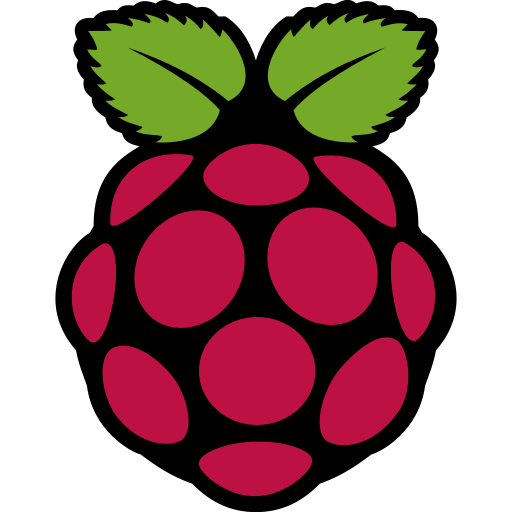
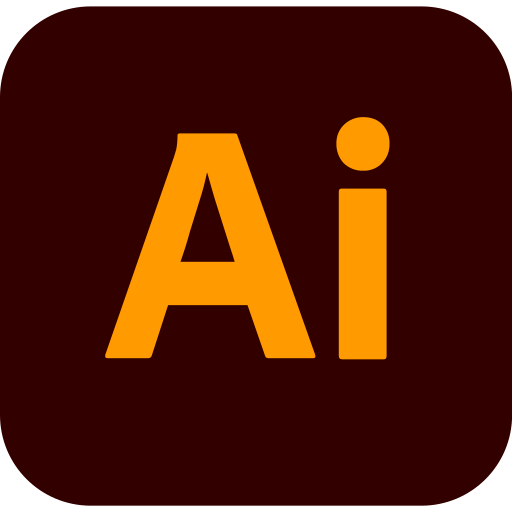
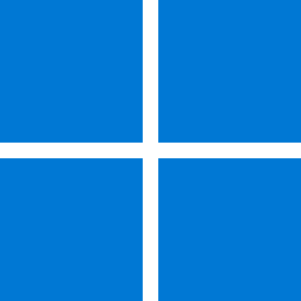
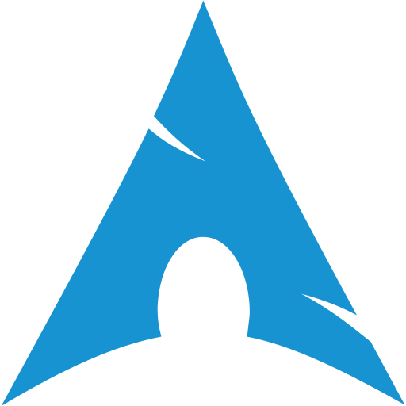
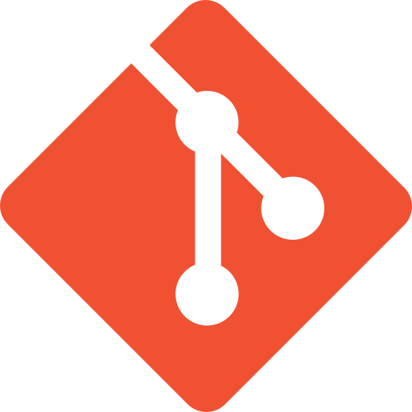

  

<h1 align="center">Hi, I'm TechieJack!</h1>

  I build self-hosted tools, Flipper Zero apps and homelab projects.

  <a href="https://me.stupif.com">Website</a> &middot; <a href="https://x.com/T3chieDev">X</a> &middot; <a href="https://me.stupif.com/#contact">Contact</a>

 

## Tech stack

  &nbsp;
  &nbsp;
  &nbsp;
  &nbsp;
  &nbsp;
  <picture><source media="(prefers-color-scheme: dark)" srcset="icons/proxmox.svg"></picture>&nbsp;
  &nbsp;
  &nbsp;
  &nbsp;
  

  &nbsp;
  <picture><source media="(prefers-color-scheme: dark)" srcset="icons/apple.svg"></picture>&nbsp;
  &nbsp;
  &nbsp;
  &nbsp;
  &nbsp;
  &nbsp;
  <picture><source media="(prefers-color-scheme: dark)" srcset="icons/github.svg"></picture>&nbsp;
  

 

## Projects

| Project | What it does | Built with |
| --- | --- | --- |
| [Shortify](https://github.com/T3chieJack/shortify) | A self-hosted link shortener in one Docker container, with text and file sharing, PIN-protected links and usage stats. | JavaScript |
| [Flipper Blinker](https://github.com/T3chieJack/FlipperBlinker) | A Flipper Zero app that sends text as Morse code through an LED wired to a GPIO pin. | C |
| [FlipperPlayer](https://github.com/T3chieJack/FlipperPlayer) | A Windows and Linux desktop player for Flipper Zero animation frames. | Python |
| [Live Year](https://github.com/T3chieJack/year-updater) | A tiny Cloudflare Worker and footer template that keep your site's copyright year up to date. | JavaScript |
| [me.stupif.com](https://github.com/T3chieJack/me) | My website, with cookieless analytics, a blog and a contact form, all on my own server. | HTML, CSS, JavaScript, Python |

 

  <a href="https://github.com/T3chieJack?tab=repositories">See everything</a>

